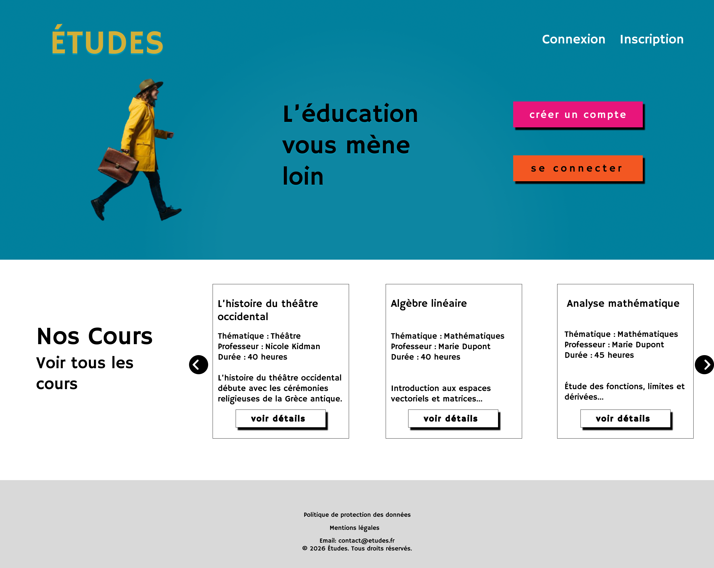
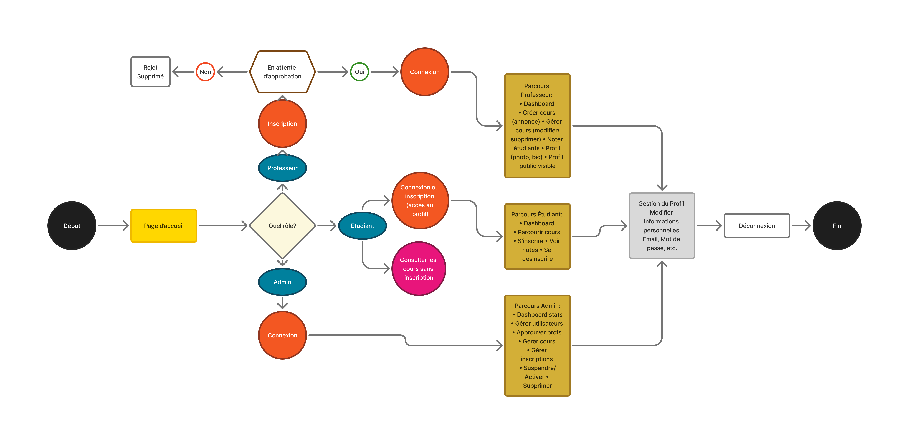
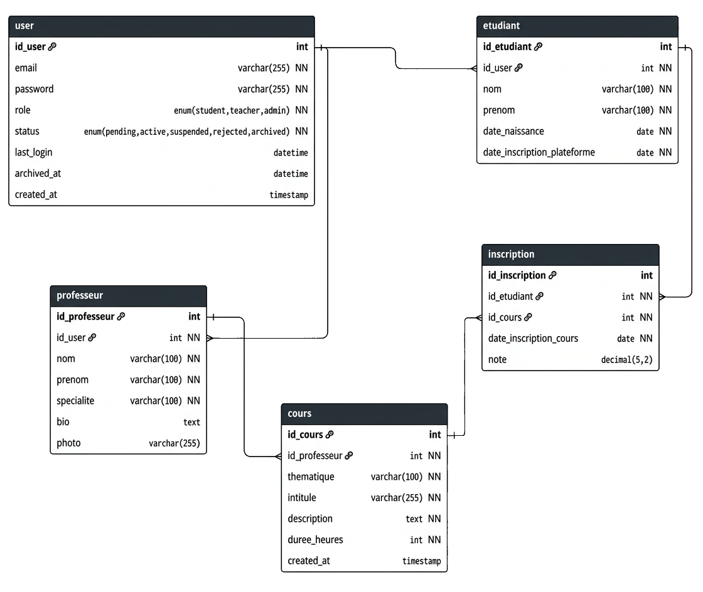

# Études, plateforme de cours en ligne

🇫🇷 Français | [🇬🇧 English](README.md)

Études est une plateforme de cours en ligne : on parcourt un catalogue, on le filtre par thématique, puis on crée un compte ou on se connecte. Trois rôles coexistent : **étudiant**, **professeur** et **administrateur**.

Projet réalisé dans le cadre de la formation de développeur web et web mobile (titre RNCP niveau 5), présenté devant le jury. J’ai conçu et développé l’ensemble : maquettes Figma, front-end, back-end PHP et base de données SQL.



## Démo en ligne

Site : <http://eduedu.freepage.cc/?i=1>

Comptes de démonstration (mots de passe de test, uniquement pour essayer) :

| Rôle | Email | Mot de passe |
|---|---|---|
| Étudiant | `etudiant1@ecole.com` | `password` |
| Professeur | `prof1@ecole.com` | `password` |

> Le site est hébergé sur un hébergeur gratuit : le premier chargement peut être lent.

## Fonctionnalités

Les parcours ci-dessous suivent le diagramme de parcours utilisateurs du projet.

**Tous les visiteurs**
- Consulter le catalogue de cours sans compte
- Rechercher un cours par mot-clé et filtrer par thématique
- Créer un compte ou se connecter

**Étudiant**
- Tableau de bord
- Parcourir les cours et s’inscrire à un cours
- Consulter ses notes
- Se désinscrire d’un cours

**Professeur** (compte en attente, soumis à l’approbation d’un administrateur)
- Tableau de bord
- Créer, modifier et supprimer ses cours
- Noter les étudiants
- Profil public avec photo et biographie

**Administrateur**
- Tableau de bord avec statistiques
- Approuver les professeurs
- Gérer les utilisateurs (suspendre, activer, supprimer), les cours et les inscriptions

**Pour tous les rôles connectés** : modifier ses informations personnelles (email, mot de passe), se déconnecter.

## Parcours utilisateurs



## Technologies

- **Front-end** : HTML, CSS, JavaScript
- **Back-end** : PHP, architecture MVC
- **Base de données** : MySQL 8.0.16+ ou MariaDB 10.2+
- **Design** : Figma (maquettes desktop et mobile, design system)
- **Hébergement** : InfinityFree (PHP/SQL)

## Architecture

Le projet suit le modèle **MVC** : la logique (contrôleurs), les données (modèles) et l’affichage (vues) sont séparés pour un code plus simple à maintenir.

```
index.php        point d’entrée
config/          configuration (base de données, session, fuseau horaire)
controllers/     logique de l’application
models/          accès aux données
views/           pages affichées
public/          fichiers publics (CSS, JS, images)
sql/             schéma et données de test
```

## Base de données

Modélisation en trois étapes : modèle conceptuel (MCD), modèle logique (MLD), puis modèle physique (MPD). La base `ecole_en_ligne` compte **5 tables** :

| Table | Rôle |
|---|---|
| `user` | Comptes de tous les rôles : email, mot de passe haché, rôle (`student`, `teacher`, `admin`), statut (`pending`, `active`, `suspended`, `rejected`, `archived`), dernière connexion et date d’archivage |
| `etudiant` | Profil étudiant, lié à un utilisateur |
| `professeur` | Profil professeur : spécialité, biographie et photo, lié à un utilisateur |
| `cours` | Cours : thématique, intitulé, description, durée, professeur |
| `inscription` | Relie étudiants et cours (relation plusieurs-à-plusieurs) et porte la date d’inscription et la note, de 0 à 20 |

Les champs `last_login` et `archived_at` permettent le suivi d’activité et l’archivage des comptes inactifs, dans une logique de conformité RGPD.



Données de test fournies : 1 administrateur, 5 professeurs plus 1 en attente d’approbation, 10 étudiants, 10 cours et leurs inscriptions.

## Design

Maquettes réalisées sur Figma, en version desktop et iPhone : accueil, catalogue, connexion et menu mobile.

**Typographie** : Hammersmith One, pour tout le site et le logo.

| Couleur | Code | Rôle |
|---|---|---|
| 🟦 | `#00809D` | Principale |
| 🟧 | `#F35722` | Action principale |
| 🟪 | `#E8157B` | Action secondaire |
| 🟨 | `#FFD700` | Accent |
| 🟨 | `#D3AF37` | Logo |
| ⬜ | `#FFFFFF` | Fond |
| ⬜ | `#D9D9D9` | Pied de page |
| ⬛ | `#000000` | Texte |

## Installation en local

**Prérequis** : un serveur local avec PHP et MySQL ou MariaDB (XAMPP, MAMP ou WAMP).

1. Cloner le dépôt dans le dossier public du serveur (`htdocs`), sous le nom `teaching-project` :
   ```bash
   cd /chemin/vers/htdocs
   git clone https://github.com/Nanako978/Teaching-project.git teaching-project
   ```
2. Importer la base de données :
   ```bash
   mysql -u root -p < teaching-project/sql/NOM-DU-FICHIER.sql
   ```
   ⚠️ Le script recrée les tables de la base `ecole_en_ligne` : les données existantes sont perdues.
3. Vérifier la configuration dans le dossier `config/`. Valeurs par défaut : hôte `localhost`, utilisateur `root`, mot de passe vide, base `ecole_en_ligne`, `BASE_URL` = `http://localhost/teaching-project`. Adapter si besoin (autre port, autre nom de dossier…).
4. Ouvrir <http://localhost/teaching-project>.

Comptes de test créés par le script SQL (en local uniquement) :

| Rôle | Email |
|---|---|
| Administrateur | `admin@ecole.com` |
| Professeur | `prof1@ecole.com` à `prof5@ecole.com` |
| Professeur en attente | `prof_pending@ecole.com` |
| Étudiant | `etudiant1@ecole.com` à `etudiant10@ecole.com` |

Mot de passe des comptes étudiants et professeurs : `password`. Le mot de passe de l’administrateur n’est pas publié.

Le fichier de configuration ne contient que des valeurs locales par défaut : ne jamais y mettre les identifiants d’un serveur en ligne.

## Sécurité

- **Mots de passe hachés** : ils sont stockés avec `password_hash()` (`PASSWORD_DEFAULT`, soit bcrypt), jamais en clair. Le hachage est à sens unique, et un sel aléatoire est ajouté automatiquement : deux utilisateurs ayant le même mot de passe ont des hashs différents, ce qui rend inutiles les tables de hashs pré-calculées. Bcrypt est volontairement lent, pour freiner les attaques par force brute.
- **Protection contre les injections SQL** : toutes les requêtes passent par PDO avec des requêtes préparées (`prepare()` et `bindParam()`), dans toutes les classes (`User.php`, `Teacher.php`, `Course.php`, `Inscription.php`). La structure de la requête est envoyée séparément des données de l’utilisateur, qui ne sont donc jamais interprétées comme du SQL.
- **Contrôle d’accès par statut** : un compte professeur est créé avec le statut `pending` et doit être validé par un administrateur avant de pouvoir se connecter. Un compte peut aussi être suspendu (`suspended`). Personne ne peut donc publier de cours sans validation humaine.

## Pistes d’amélioration

- **Changement et réinitialisation du mot de passe** : un formulaire dans la page de profil, et un « mot de passe oublié » par email
- **Tests automatisés** : tests unitaires des modèles (PHPUnit) et quelques vérifications des parcours principaux
- **Pagination du catalogue** : pour garder une page rapide quand le nombre de cours augmente
- **Audit d’accessibilité** : contrastes de couleurs, navigation au clavier et libellés pour les lecteurs d’écran
- **Version anglaise** de l’interface

## Auteure

**Nanako** (Naïri Nikoghosian), développement web, webdesign, UX/UI et animation.
