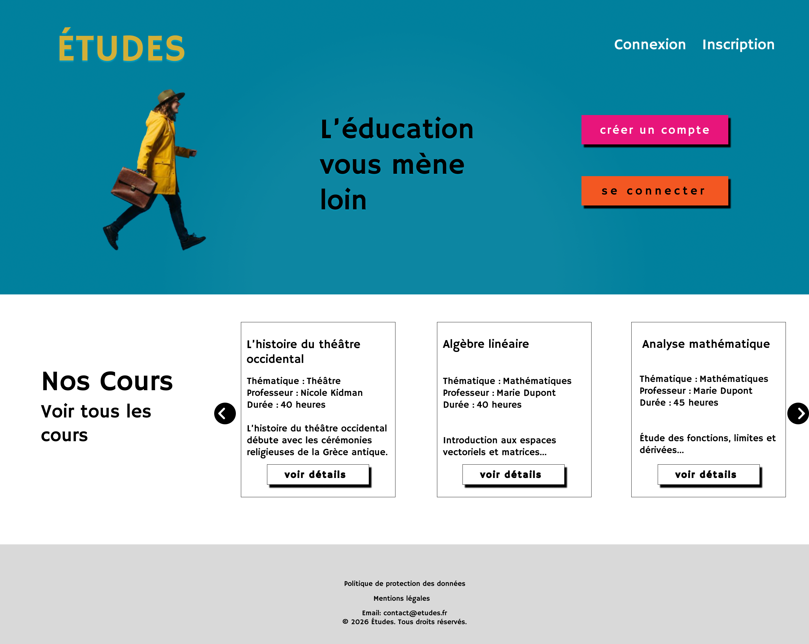
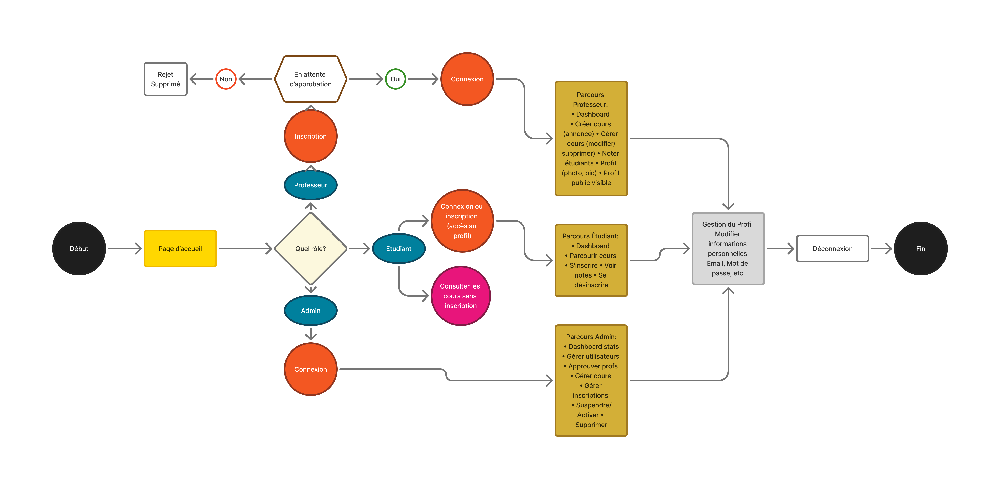
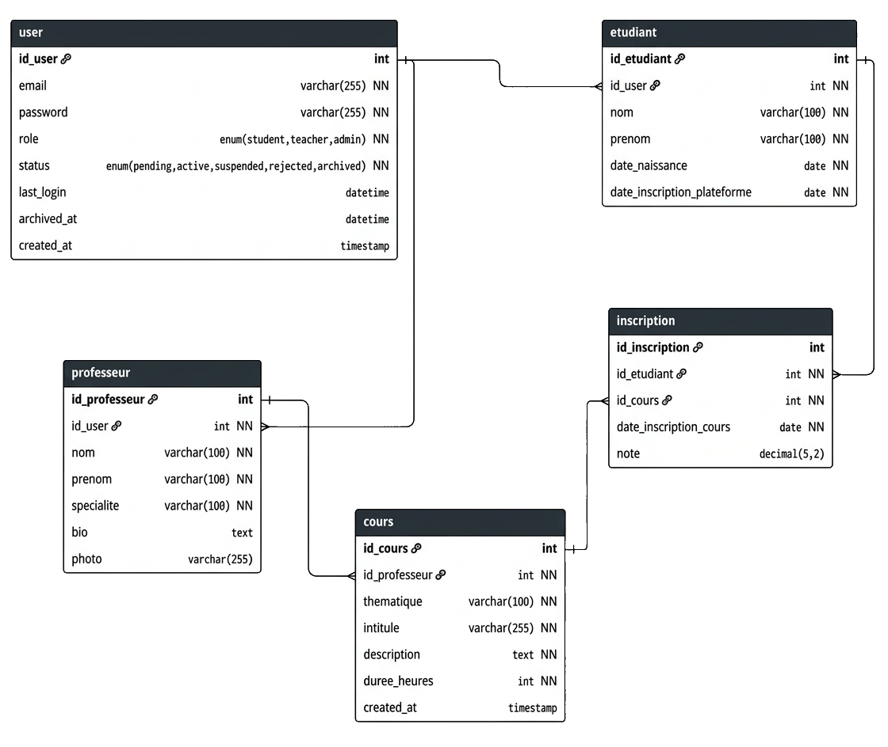

# Études, online course platform

[🇫🇷 Français](README.fr.md) | 🇬🇧 English

Études is an online course platform: users browse a catalogue, filter it by theme, then create an account or log in. Three roles coexist: **student**, **teacher** and **administrator**.

Built as part of the web and mobile web development training (RNCP Level 5 certification) and presented to the jury. I designed and developed everything: Figma mockups, front-end, PHP back-end and SQL database.



## Live demo

Site: <http://eduedu.freepage.cc/?i=1>

Demo accounts (test passwords, just to try the site):

| Role | Email | Password |
|---|---|---|
| Student | `etudiant1@ecole.com` | `password` |
| Teacher | `prof1@ecole.com` | `password` |

> The site runs on a free host, so the first load may be slow.

## Features

The journeys below follow the project's user flow diagram.

**All visitors**
- Browse the course catalogue without an account
- Search courses by keyword and filter by theme
- Create an account or log in

**Student**
- Dashboard
- Browse courses and enrol in a course
- View grades
- Unenrol from a course

**Teacher** (account stays pending until approved by an administrator)
- Dashboard
- Create, edit and delete their own courses
- Grade students
- Public profile with photo and bio

**Administrator**
- Dashboard with statistics
- Approve teachers
- Manage users (suspend, activate, delete), courses and enrolments

**For every logged-in role**: edit personal information (email, password), log out.

## User flows



## Tech stack

- **Front-end**: HTML, CSS, JavaScript
- **Back-end**: PHP, MVC architecture
- **Database**: MySQL 8.0.16+ or MariaDB 10.2+
- **Design**: Figma (desktop and mobile mockups, design system)
- **Hosting**: InfinityFree (PHP/SQL)

## Architecture

The project follows the **MVC** pattern: logic (controllers), data (models) and display (views) are kept separate for code that is easier to maintain.

```
index.php        entry point
config/          configuration (database, session, timezone)
controllers/     application logic
models/          data access
views/           rendered pages
public/          public files (CSS, JS, images)
sql/             schema and test data
```

## Database

Modeled in three stages: conceptual model (MCD), logical model (MLD), then physical model (MPD). The `ecole_en_ligne` database has **5 tables**:

| Table | Purpose |
|---|---|
| `user` | Accounts for every role: email, hashed password, role (`student`, `teacher`, `admin`), status (`pending`, `active`, `suspended`, `rejected`, `archived`), last login and archive date |
| `etudiant` | Student profile, linked to a user |
| `professeur` | Teacher profile: specialty, bio and photo, linked to a user |
| `cours` | Courses: theme, title, description, duration, teacher |
| `inscription` | Links students and courses (many-to-many) and holds the enrolment date and the grade, from 0 to 20 |

The `last_login` and `archived_at` fields allow activity tracking and archiving of inactive accounts, for GDPR compliance.



Test data included: 1 administrator, 5 teachers plus 1 pending approval, 10 students, 10 courses and their enrolments.

## Design

Mockups made in Figma, in desktop and iPhone versions: home, catalogue, login and mobile menu.

**Typography**: Hammersmith One, for the whole site and the logo.

| Color | Code | Role |
|---|---|---|
| 🟦 | `#00809D` | Primary |
| 🟧 | `#F35722` | Primary action |
| 🟪 | `#E8157B` | Secondary action |
| 🟨 | `#FFD700` | Accent |
| 🟨 | `#D3AF37` | Logo |
| ⬜ | `#FFFFFF` | Background |
| ⬜ | `#D9D9D9` | Footer |
| ⬛ | `#000000` | Text |

## Local installation

**Requirements**: a local server with PHP and MySQL or MariaDB (XAMPP, MAMP or WAMP).

1. Clone the repository into the server's public folder (`htdocs`), named `teaching-project`:
   ```bash
   cd /path/to/htdocs
   git clone https://github.com/Nanako978/Teaching-project.git teaching-project
   ```
2. Import the database:
   ```bash
   mysql -u root -p < teaching-project/sql/FILE-NAME.sql
   ```
   ⚠️ The script recreates the tables of the `ecole_en_ligne` database: any existing data in them is lost.
3. Check the configuration in the `config/` folder. Defaults: host `localhost`, user `root`, empty password, database `ecole_en_ligne`, `BASE_URL` = `http://localhost/teaching-project`. Adjust if needed (different port, different folder name…).
4. Open <http://localhost/teaching-project>.

Test accounts created by the SQL script (local only):

| Role | Email |
|---|---|
| Administrator | `admin@ecole.com` |
| Teacher | `prof1@ecole.com` to `prof5@ecole.com` |
| Pending teacher | `prof_pending@ecole.com` |
| Student | `etudiant1@ecole.com` to `etudiant10@ecole.com` |

Password for the student and teacher accounts: `password`. The administrator password is not published.

The configuration file only contains local default values: never put the credentials of an online server in it.

## Security

- **Hashed passwords**: they are stored with `password_hash()` (`PASSWORD_DEFAULT`, i.e. bcrypt), never in plain text. Hashing is one-way, and a random salt is added automatically: two users with the same password get different hashes, which makes precomputed hash tables useless. Bcrypt is deliberately slow, to hinder brute-force attacks.
- **SQL injection protection**: every query goes through PDO with prepared statements (`prepare()` and `bindParam()`), in all classes (`User.php`, `Teacher.php`, `Course.php`, `Inscription.php`). The query structure is sent separately from user input, so user data is never interpreted as SQL.
- **Status-based access control**: a teacher account is created with the `pending` status and must be approved by an administrator before it can log in. An account can also be suspended (`suspended`). Nobody can publish courses without human approval.

## Possible improvements

- **Change and reset password**: a form in the profile page, and a "forgot password" flow by email
- **Automated tests**: unit tests for the models (PHPUnit) and a few checks of the main user journeys
- **Catalogue pagination**: to keep the page fast as the number of courses grows
- **Accessibility audit**: color contrast, keyboard navigation and screen-reader labels
- **English version** of the interface

## Author

**Nanako** (Naïri Nikoghosian), web development, web design, UX/UI and animation.
